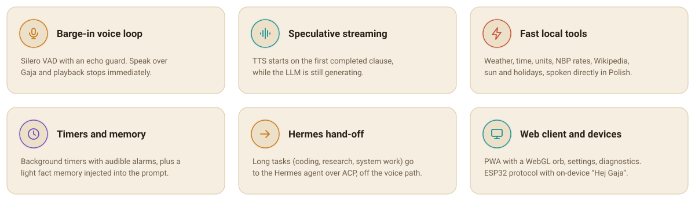
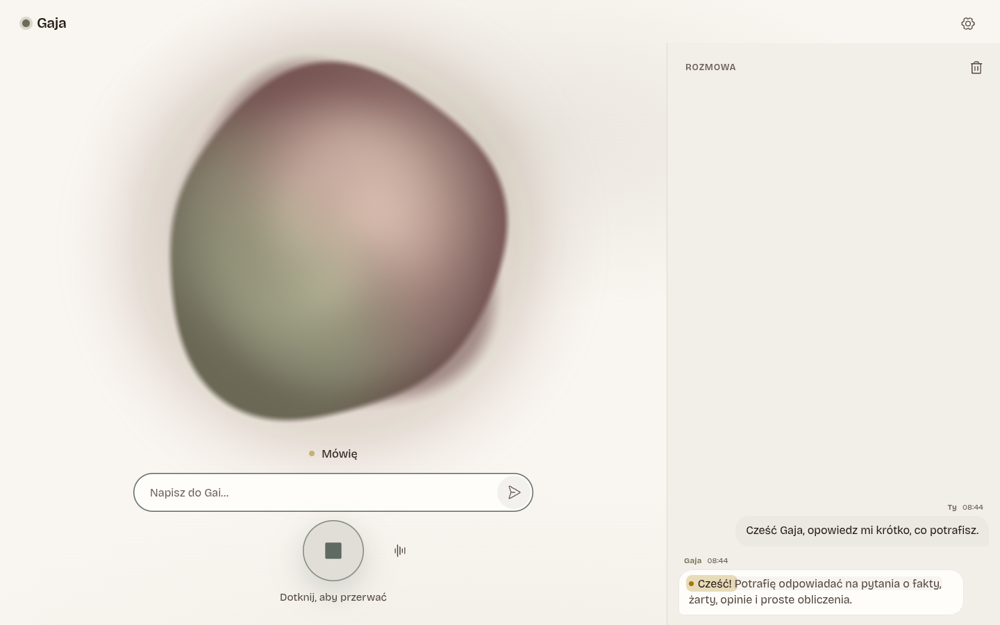
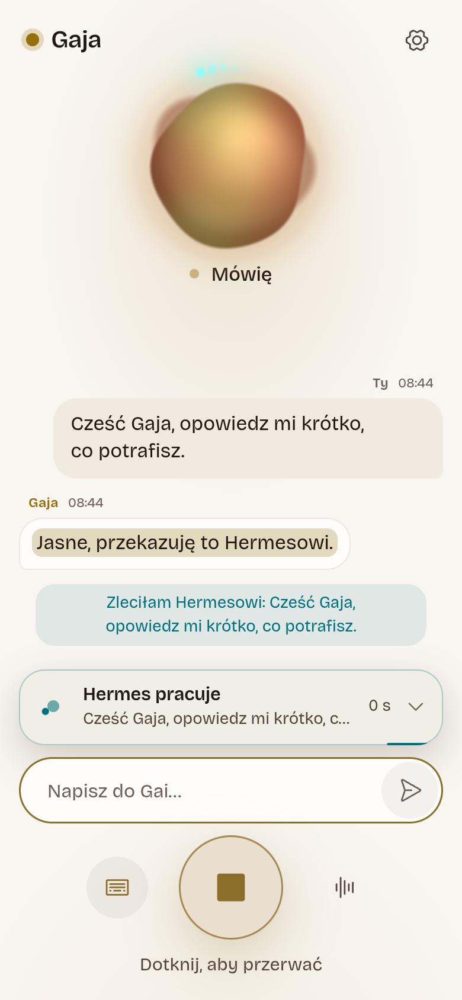
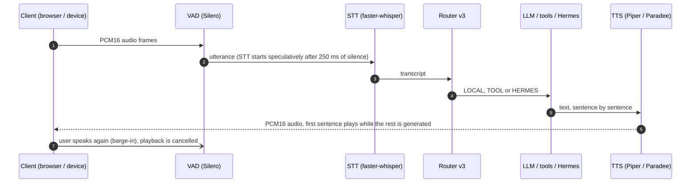

<p align="center">
  
</p>

<h1 align="center">Gaja Voice Adapter</h1>

<p align="center">
  <a href="#quick-start">Quick start</a> &middot;
  <a href="#how-it-works">How it works</a> &middot;
  <a href="#hardware-baseline--latency-measurements">Benchmarks</a> &middot;
  <a href="#configuration">Configuration</a> &middot;
  <a href="docs/ARCHITECTURE.md">Architecture</a> &middot;
  <a href="#po-polsku">Po polsku</a>
</p>

Gaja is a Polish-first, low-latency, real-time voice assistant adapter designed for local deployment. It bridges real-time audio input from browser clients (WebSockets) and ESP32 IoT hardware with local speech recognition (STT), a lightweight local language model (LLM), fast local tool execution, expressive speech synthesis (TTS), and asynchronous task delegation to the autonomous Hermes agent.

<p align="center">
  <sub>Python 3.11 &middot; FastAPI / asyncio &middot; Silero VAD &middot; faster-whisper &middot; llama.cpp (LFM2.5-2.6B) &middot; Piper TTS &middot; plain HTML/JS web client</sub>
</p>

<picture>
  <source media="(prefers-color-scheme: dark)" srcset="docs/assets/features-dark.svg">
  
</picture>

## The web client

Zero-framework PWA served by the adapter itself: a WebGL orb visualises the assistant state, a side drawer keeps the conversation, and Hermes tasks show live progress. Screenshots come from the real running client ([docs/WEB_CLIENT.md](docs/WEB_CLIENT.md), in Polish).

<p align="center">
  <picture>
    <source media="(prefers-color-scheme: dark)" srcset="docs/ui/real-desktop-dark-conversation-speaking.png">
    
  </picture>
  &nbsp;
  <picture>
    <source media="(prefers-color-scheme: dark)" srcset="docs/ui/real-phone-dark-conversation-speaking.png">
    
  </picture>
</p>

---

## Features in detail

- **Real-Time Voice Loop with Barge-In**: Sub-second voice streaming with Silero VAD, acoustic echo suppression, and Smart Turn end-of-speech boundary detection. User interruptions immediately cancel playing audio buffers.
- **Speculative Sentence Streaming**: Replies are chunked and dispatched to TTS on the first completed clause, allowing audio playback to begin while the language model is still generating.
- **Fast Local Tools (Variant C Direct Speak)**: Local tools (weather, time, calculator, NBP currency rates, Wikipedia summaries, units, server health, and Polish holidays, alongside the sun, timer and memory tools below) execute in ~1.5–2.5 s, speaking deterministic Polish replies directly without a redundant second LLM generation turn.
- **Timers & Reminders**: Background timer management (`gaja/timers.py`, `manage_timer` tool, and REST API) with live countdowns, audio alarm synthesis, and WebSocket notification dispatch to connected clients.
- **Light Fact Memory**: Local user fact storage and retrieval (`gaja/memory.py`, `remember`/`forget` tools, and REST API) providing persistent personalization injected into system prompt turns.
- **Offline Astronomical & Date Calculations**: Local offline sunrise/sunset calculations (`gaja/tools/sun_tool.py`), Polish holidays database (`holiday_tool.py`), and date arithmetic (`time_tool.py`) running with zero external network dependency.
- **Conversation History**: Multi-turn dialogue history tracking (`gaja/llm/history.py`) retained across turns and accessible via web client drawer.
- **Interactive Web Client & PWA**: Zero-framework web application featuring a WebGL fragment shader orb visualising state, push-to-talk, audio device switching, offline service worker, PWA manifest, and responsive mobile layout.
- **Settings Panel & Diagnostics**: Comprehensive in-app configuration panel for audio devices, TTS voices/engines, latency metrics, and real-time backend diagnostics (`/diagnostics.html`).
- **Smart Turn Boundary Detection (Experimental)**: Optional semantic end-of-turn detection (`gaja/audio/smart_turn.py`, off by default) complementing Silero VAD to eliminate unnatural pauses without cutting off speaker contemplation.
- **Hermes Agent Hand-Off**: Autonomous delegation of complex or long-running tasks (coding, research, system operations) to the Hermes agent via a persistent ACP protocol worker over stdio.
- **IoT Hardware & Devices Support**: Server protocol support for ESP32-S3 devices (e.g. M5Stack Atom/EchoS3R) running on-device wake-word detection over UDP/TCP. Verified against the bundled device simulator; no physical device has been tested yet ([docs/DEVICE.md](docs/DEVICE.md)).
- **On-Device Wake Word & Audio Recorder**: Support for "Hej Gaja" via microWakeWord, plus a built-in browser recorder (`/record.html`) for collecting training and evaluation samples.

---

## How it works

Detailed architectural contracts, message formats, and protocols are documented in [docs/ARCHITECTURE.md](docs/ARCHITECTURE.md).

<picture>
  <source media="(prefers-color-scheme: dark)" srcset="docs/assets/pipeline-dark.svg">
  
</picture>

One voice turn, from microphone to speaker:



- **LOCAL** answers with the streamed local LLM, **TOOL** speaks the tool's own Polish sentence directly (no second LLM pass), **HERMES** hands the task to the agent in the background and keeps the conversation going.
- Smart Turn end-of-speech detection is optional and off by default.

<details>
<summary>Plain-text version of the diagram</summary>

```
   [ Browser / PWA / ESP32 Device ]
                 │
           (PCM16 Audio over WebSocket / TCP)
                 ▼
      ┌─────────────────────┐
      │  Gaja Voice Adapter │  (FastAPI / asyncio)
      └──────────┬──────────┘
                 ├──────────────────────────────┐
                 ▼                              ▼
        [ Silero VAD / STT ]           [ Smart Turn EOS ]
        (Whistle / faster-whisper)
                 │
                 ▼
      [ Router v3 Logprob Classifier ]
        (1-token /completion on llama-server)
          │            │               │
      [ LOCAL ]    [ TOOL ]       [ HERMES ]
          │            │               │
     LFM2.5-2.6B    Variant C      Hermes ACP
     llama-server   Direct Speak   Background Task
          │            │               │
          └─────┬──────┘               ▼
                ▼              Progress & Results
       [ Text Normalizer ]
                │
                ▼
        [ Piper TTS / CPU ]
         (Gosia / Darkman)
                │
           (WAV Audio)
                ▼
      [ Client Playback ]
```

</details>

---

## Hardware Baseline & Latency Measurements

Gaja was built and benchmarked on commodity consumer hardware:
- **CPU**: Intel Core i5-8300H (4 cores / 8 threads)
- **RAM**: 15 GB
- **GPU**: NVIDIA GeForce GTX 1050 Ti (4 GB VRAM, Pascal sm_61)

<picture>
  <source media="(prefers-color-scheme: dark)" srcset="docs/assets/benchmarks-dark.svg">
  
</picture>

Measured headline metrics from repository benchmarks:

- **Speech-to-Text (STT)** ([docs/STT_RESULTS.md](docs/STT_RESULTS.md)):
  - *Production (faster-whisper `small` int8 on CUDA, beam 1)*: Conversational latency **0.395 s p50 / 0.436 s p90** (RTF 7.70), Polish WER **18.69%** (cutting word errors nearly in half compared to the CPU baseline), within 3825 MiB peak VRAM alongside `llama-server`.
  - *Fallback (WhistlePy in-process Whisper on CPU)*: Conversational latency median **0.266–0.466 s** (p90 0.716–1.053 s, Polish WER 36.11%), RSS ~101.4 MB without GPU contention.
- **Language Model & Routing** ([docs/LLM_RESULTS.md](docs/LLM_RESULTS.md)):
  - *LiquidAI LFM2.5-2.6B (Q4_K_M on llama-server)*: Alone generation speed **31.3–34.0 tokens/s** (29.4–31.9 ms/token) with prefill at **193.0–531.7 tokens/s**.
  - *Time to First Token (TTFT)*: **~200–250 ms** with warm prefix prompt cache.
  - *Router v2 / v3 Classifier*: Median classification latency **53.89 ms** (~54 ms, 1 token `/completion`), achieving **0.950 Precision**, **0.950 Recall**, and **0.950 F1** on an 80-case holdout dataset.
- **Text-to-Speech (TTS)** ([docs/TTS_RESULTS.md](docs/TTS_RESULTS.md)):
  - *Piper `pl_PL-gosia-medium` (Polish default on CPU)*: Real-Time Factor (RTF) **15.74**, Time to First Audio (TTFA) median **0.27 s** (< 0.3 s target), streaming sentence-by-sentence.
  - *Paradee-8M (English default on CPU)*: RTF **9.65**, TTFA median **0.43 s** (0.32 s for short sentences).
- **Fast Local Tools** ([docs/TOOLS.md](docs/TOOLS.md)):
  - *Variant C (Direct Speak)*: Evaluated on 119 benchmark samples ([bench/results/tools_eval_comparison.json](bench/results/tools_eval_comparison.json)), achieving **90.76%** action accuracy (85.71% tool selection & argument accuracy) and median end-to-end latency of **2154.5 ms** (p90 3184.4 ms), speaking deterministic Polish tool outputs directly without a second LLM generation turn.

> [!NOTE]
> Detailed benchmark and evaluation reports [docs/LLM_RESULTS.md](docs/LLM_RESULTS.md), [docs/TOOLS.md](docs/TOOLS.md), and [docs/WEB_CLIENT.md](docs/WEB_CLIENT.md) are currently maintained in Polish.

---

## Quick Start

See [docs/SETUP.md](docs/SETUP.md) for full installation and system requirements.

### 1. Requirements

- Linux
- Python 3.11
- `uv` package manager
- `llama-server` (llama.cpp) with GPU support

### 2. Environment Setup

```bash
# Clone repository and synchronize dependencies
git clone <repo-url> gaja-hermes-adapter
cd gaja-hermes-adapter
uv sync
```

### 3. Run the Services

Start the local LLM server and the Gaja adapter:

```bash
# In terminal 1: Start llama-server (LFM2.5-2.6B)
llama-server -m models/lfm2.5-2.6b-q4_k_m.gguf --host 127.0.0.1 --port 8791 -ngl 99 -c 8192 -np 2 --no-kv-unified --jinja --chat-template-file deploy/lfm_nothink.jinja --reasoning-budget 0 -fa on

# In terminal 2: Start Gaja adapter
uv run python -m gaja
```

Systemd user service templates and an automated installation script are provided in `deploy/` and `scripts/install_units.sh`.

### 4. Open Web Interface or Test via CLI

- **Web Browser**: Open `http://localhost:8790` in Chrome, Safari, or Firefox.
- **CLI Client**:
  ```bash
  # Send text query
  uv run python clients/cli_wav.py --text "Która jest godzina?"

  # Stream audio file
  uv run python clients/cli_wav.py path/to/audio.wav
  ```

---

## Configuration

Configuration is managed via Pydantic Settings in [gaja/config.py](gaja/config.py), evaluated in the following order of precedence (highest to lowest):

1. **Explicit keyword arguments** passed to `Settings(...)`.
2. **Environment variables** with the prefix `GAJA_` and double underscores (`__`) for nested keys:
   ```bash
   export GAJA_SERVER__PORT=8790
   export GAJA_LLM__TEMPERATURE=0.2
   ```
3. **Local overrides** in `config.local.toml` (git-ignored, optional):
   Used to configure machine-specific settings such as custom Tailscale origins or explicit Hermes binary paths.
4. **Project defaults** in `config.toml`.

### Example `config.local.toml`

```toml
[server]
# Add custom domain or Tailscale HTTPS origin for remote microphone access
allowed_origins = [
  "http://localhost:8790",
  "https://localhost:8790",
  "http://127.0.0.1:8790",
  "https://127.0.0.1:8790",
  "https://my-host.my-tailnet.ts.net:8443",
]

[hermes]
# Specify an absolute path if hermes is not in system PATH
command = ["/usr/local/bin/hermes", "acp"]
```

---

## Repository Layout

```
.
├── assets/             # Icons and visual assets
├── bench/              # Benchmark evaluation scripts, datasets, and results
│   ├── data/           # Holdout evaluation sets (routing, tools, quality, audio)
│   └── results/        # Raw JSON benchmark records
├── clients/            # CLI test clients, real adapter checks, and mock server
├── deploy/             # Systemd user service templates and jinja chat templates
├── docs/               # Architecture, protocols, hardware notes, and benchmarks
│   ├── assets/         # README graphics (hand-written SVGs)
│   ├── ui/             # Web client screenshots
│   ├── ADAPTER.md      # Core pipeline contract and lifecycle
│   ├── ARCHITECTURE.md # System architecture, interfaces, and cross-stream contracts
│   ├── DEVICE.md       # IoT hardware protocol specification
│   ├── HERMES.md       # Hermes ACP integration analysis
│   ├── LLM_RESULTS.md  # Routing and LLM benchmarks
│   ├── STT_RESULTS.md  # Speech-to-text benchmark results
│   ├── TOOLS.md        # Local tools evaluation and specifications
│   ├── TTS_RESULTS.md  # Speech synthesis benchmarks
│   └── WEB_CLIENT.md   # Web client and PWA documentation
├── gaja/               # Core application package
│   ├── api/            # REST API routers (memory, timers)
│   ├── audio/          # VAD, audio chunking, and Smart Turn detection
│   ├── hermes/         # Hermes ACP client and background task lifecycle
│   ├── llm/            # llama-server client and Router v3 classification
│   ├── text/           # Text normalization and phonetic preprocessing
│   ├── tools/          # Async local tool implementations
│   ├── config.py       # Pydantic configuration hierarchy
│   ├── memory.py       # Light fact memory store
│   ├── pipeline.py     # Real-time turn orchestrator
│   ├── server.py       # FastAPI application and WebSocket endpoints
│   └── timers.py       # Async background timers engine
├── prompts/            # Production system and router prompts
├── scripts/            # Unit install scripts and testing utilities
├── tests/              # Pytest test suite
└── web/                # Zero-build single-page web client and PWA
```

---

## Development

### Running Tests

```bash
# Run unit and integration tests (fast)
uv run pytest -q --ignore=tests/test_web_e2e.py

# Run Playwright E2E browser tests (requires browser dependencies)
flock /tmp/gaja-e2e.lock uv run pytest -q tests/test_web_e2e.py
```

### Running Benchmarks

Benchmark scripts are located in `bench/`:
- **STT evaluation**: `bash bench/run_stt_matrix.sh`
- **TTS synthesis benchmarks**: `bash bench/tts_final.sh all`
- **Routing evaluation**: `uv run python bench/routing_eval.py`
- **Tool evaluation**: `uv run python bench/tools_eval.py`

All timed benchmark executions should be wrapped under `flock /tmp/gaja-bench.lock`.

---

## Licence

Distributed under the MIT Licence. See [LICENSE](LICENSE) for details.

Copyright (c) 2026 Tymoteusz Bielski.

---

## Po polsku

Gaja to adapter asystentki głosowej zoptymalizowany pod kątem języka polskiego, działający w czasie rzeczywistym z minimalnym opóźnieniem na sprzęcie konsumenckim.

### Główne cechy

- **Pętla głosowa z przerwaniem wypowiedzi (barge-in)**: Natychmiastowe zatrzymanie odtwarzania głosu po wykryciu mowy użytkownika (Silero VAD + echo guard + Smart Turn).
- **Strumieniowanie spekulatywne**: Rozpoczęcie syntezy mowy (TTS) po wygenerowaniu pierwszego zdania przez model LLM.
- **Szybkie narzędzia lokalne (Wariant C Direct Speak)**: Pogoda, czas, kalkulator, kursy walut NBP, Wikipedia, status serwera i święta w ~1.5–2.5 s bez zbędnej drugiej tury LLM.
- **Timery i przypomnienia**: Zarządzanie minutnikami w tle (`gaja/timers.py`, narzędzie `manage_timer`, REST API i alerty WebSocket).
- **Lekka pamięć faktów**: Zapamiętywanie faktów o użytkowniku (`gaja/memory.py`, narzędzia `remember`/`forget`, REST API).
- **Obliczenia astronomiczne i kalendarzowe offline**: Wschody i zachody słońca (`sun_tool.py`), baza polskich świąt (`holiday_tool.py`) i arytmetyka dat bez dostępu do sieci.
- **Historia konwersacji**: Wieloturowa historia rozmowy (`gaja/llm/history.py`) dostępna w szufladzie interfejsu.
- **Współpraca z agentem Hermes**: Automatyczne przekazywanie złożonych zadań (kodowanie, research, system) do agenta Hermes przez protokół ACP.
- **Klient webowy i PWA**: Interfejs w przeglądarce (`http://localhost:8790`) z kulą WebGL, panelem ustawień, diagnostyką i wsparciem dla urządzeń mobilnych.
- **Własne słowo wybudzające ("Hej Gaja")**: Narzędzie do nagrywania próbek pod adresem `/record.html`.

### Szybki start

```bash
# Instalacja zależności
uv sync

# Uruchomienie adaptera
uv run python -m gaja
```

Więcej informacji w plikach [docs/SETUP.md](docs/SETUP.md) oraz [docs/ARCHITECTURE.md](docs/ARCHITECTURE.md).
